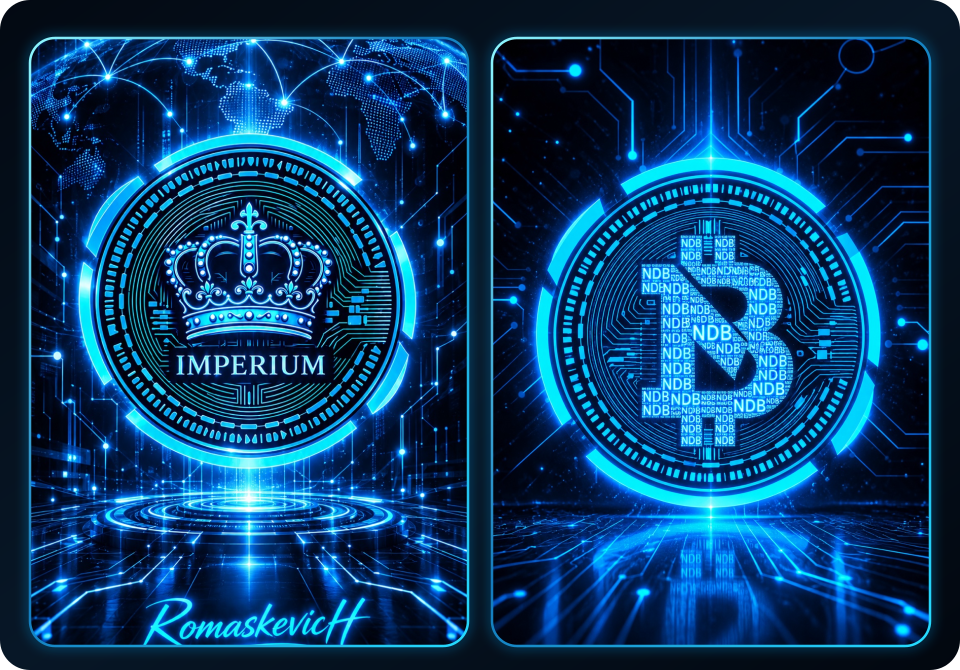

  

  

<h1 align="center">IMPERIAL Core</h1>

<strong>Building software and autonomous AI systems people can trust.</strong>

Architecture → Implementation → Evidence

  <a href="https://oromaskevic23-cmd.github.io/Capital-Core-Public/reference/constructor-ai/studio/studio.html">Product demo</a> ·
  <a href="https://oromaskevic23-cmd.github.io/oromaskevic23-cmd/">Founder website</a> ·
  <a href="https://oromaskevic23-cmd.github.io/Capital-Core-Public/">Ecosystem website</a> ·
  <a href="https://github.com/oromaskevic23-cmd/oromaskevic23-cmd/blob/main/docs/CONSTRUCTOR_AI_INVESTOR_OVERVIEW.md">Investor overview</a>

## A long-term engineering ambition

IMPERIAL Core is a founder-led technology ecosystem under development. Our goal is to build useful AI products and an infrastructure in which autonomous agents can work together without sacrificing security, accountability or human control.

We start with a practical product: CONSTRUCTOR AI. The wider ecosystem brings together AI orchestration, model intelligence, professional agent teams, security and research into trusted digital infrastructure.

  

<h2 align="center">Alexander Romaskevich</h2>

<strong>Founder · Owner · CEO</strong> RomaskevicH

### A message from the founder

I want IMPERIAL Core to become a lasting technology organization, one that earns trust through the quality of its work. My focus is on practical products, responsible autonomy and engineering decisions that can withstand independent scrutiny.

We are building toward that vision step by step. I welcome conversations with people who value long-term thinking, sound engineering and measurable progress.

## CONSTRUCTOR AI — our flagship product

CONSTRUCTOR AI is being developed as an AI-native software engineering environment. The aim is to help people create software, inspect the source, verify its behavior and retain control of the release.

Today, the public Template Studio can export three reviewed local applications: a Task Manager, Business CRM and Business Dashboard. The exports contain editable source code, tests and integrity manifests. This is a useful starting point, not yet a general-purpose autonomous application factory.

[Try the Template Studio](https://oromaskevic23-cmd.github.io/Capital-Core-Public/reference/constructor-ai/studio/studio.html) · [Explore the repository](https://github.com/oromaskevic23-cmd/CONSTRUCTOR-AI) · [Acceptance procedure](https://github.com/oromaskevic23-cmd/CONSTRUCTOR-AI/blob/898d1abe2616cb92104b64dc126e0875cc9acddf/docs/FLAGSHIP_ACCEPTANCE.md)

## Engineering evidence

These are specific, inspectable development records, not commercial or production-readiness claims.

| Project | What the evidence establishes |
| --- | --- |
| CONSTRUCTOR AI | [Reference CI](https://github.com/oromaskevic23-cmd/CONSTRUCTOR-AI/actions/runs/42001525579) and [Chromium acceptance](https://github.com/oromaskevic23-cmd/CONSTRUCTOR-AI/actions/runs/42001525556) cover reviewed local templates at [revision 898d1abe](https://github.com/oromaskevic23-cmd/CONSTRUCTOR-AI/commit/898d1abe2616cb92104b64dc126e0875cc9acddf). |
| CONSTRUCTOR AI — real-model research | [PR #24](https://github.com/oromaskevic23-cmd/CONSTRUCTOR-AI/pull/24) records a real Qwen experiment whose browser verifier failed. A follow-up fixes verifier handling; successful end-to-end acceptance is not yet established. |
| AGY | [Local Protocol Tests](https://github.com/oromaskevic23-cmd/AGY/actions/runs/43118953561) report 91 passing tests and three offline demonstrations, including a disposable worker stop and signed resume. [PR #7](https://github.com/oromaskevic23-cmd/AGY/pull/7) remains a research increment, not a live blockchain. |

The [engineering due-diligence brief](docs/ENGINEERING_DUE_DILIGENCE_20261109.md) and [evidence dossier](https://oromaskevic23-cmd.github.io/oromaskevic23-cmd/engineering/) provide additional context. Repository-controlled tests are not independent certification. Customer revenue, commercial readiness and an operating global agent fleet are not established here.

## Technology portfolio

| Project | Purpose |
| --- | --- |
| [CONSTRUCTOR AI](https://github.com/oromaskevic23-cmd/CONSTRUCTOR-AI) | AI-assisted software engineering and verified delivery |
| [VELION](https://github.com/oromaskevic23-cmd/VELION-LLM-Public) | Model intelligence and governed routing; MAX is a mode |
| [HANTER](https://github.com/oromaskevic23-cmd/HANTER-Public) | AI Command Center and mission coordination |
| [Nano Core Agents](https://github.com/oromaskevic23-cmd/Nano-Core-Agents-Public) · [LEGION](https://github.com/oromaskevic23-cmd/Legion-Public) | Specialized AI agents and professional teams |
| [ORION](https://github.com/oromaskevic23-cmd/ORION-Public) | Collective intelligence |
| [CYBER HAK](https://github.com/oromaskevic23-cmd/CYBER-HAK-Public) | Defensive security and controlled execution |
| [AGY](https://github.com/oromaskevic23-cmd/AGY) | Research into identity, evidence and trust for autonomous intelligence |
| [Capital Core](https://github.com/oromaskevic23-cmd/Capital-Core-Public) | Business and real-estate applications |
| [CRYPTO IMPERIAL Ecosystem](https://github.com/oromaskevic23-cmd/CRYPTO-IMPERIAL-Ecosystem-Public) | Separate digital-asset research and contract references |

[Public project registry](docs/FOUNDER_PUBLIC_PROJECT_REGISTRY_20261031.md) · [Ecosystem reference](https://oromaskevic23-cmd.github.io/Capital-Core-Public/reference/)

## Architecture and human control

  

The target architecture is a **Federated Multi-Orchestrator Architecture**. HANTER coordinates missions, while specialized orchestrators manage their own organizations, professional teams and Nano Core Agents. ORION supports collective intelligence.

AI Passport identifies agents; Enterprise Skills define their capabilities. Guardian Core evaluates policy, Approval Gateway handles approvals and Audit Ledger records relevant actions. Zero Trust, the Owner Kill Switch, the Public/Private Boundary and the CRYPTO IMPERIAL Ecosystem Boundary are core design requirements.

These are architectural commitments. Each operational capability must be demonstrated separately before it is described as working.

## CRYPTO IMPERIAL Ecosystem

  

  <a href="https://github.com/oromaskevic23-cmd/IMPERIUM"><strong>IMPERIUM</strong></a> &nbsp;·&nbsp;
  <a href="https://github.com/oromaskevic23-cmd/N.D.B"><strong>NDB</strong></a>

**IMPERIUM** is a long-term architectural digital currency envisioned for AI agents worldwide.

**NDB** is a separate token project. This direction is distinct from the software business.

> We make no claim of current global adoption, liquidity, investment returns or an operational agent-payment service.

## What comes next

Our engineering priority is a complete, bounded real-model application workflow with reproducible tests, isolated execution and independently reviewable evidence. Independent review and a carefully scoped customer pilot are the next steps toward a commercial product. For AGY, the next major research milestone is a verifiable multi-node Devnet, not a claim of an existing network.

## Work with us

We welcome discussions with prospective pilot customers, technical partners and investors. Start by exploring the demo and the engineering evidence, then contact us to discuss a specific opportunity.

[Investor and pilot overview](docs/CONSTRUCTOR_AI_INVESTOR_OVERVIEW.md) · [Contact](mailto:oromaskevic23@gmail.com) · [Technical collaboration](https://github.com/oromaskevic23-cmd/Capital-Core-Public/issues)

This GitHub profile is a public, Git-managed presentation of IMPERIAL Core. It does not depend on Instagram authorization, an Instagram API or social-media tokens.

---

**Alexander Nikolaevich Romaskevich · RomaskevicH**  
Founder · Owner · CEO, IMPERIAL Core

[Authorship and provenance](NOTICE.md) · [Corporate symbol policy](brand/README.md)

Third-party components retain their original attribution and applicable licenses. Public visibility does not by itself grant a software license.
