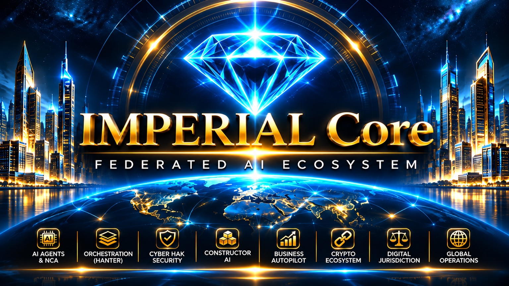
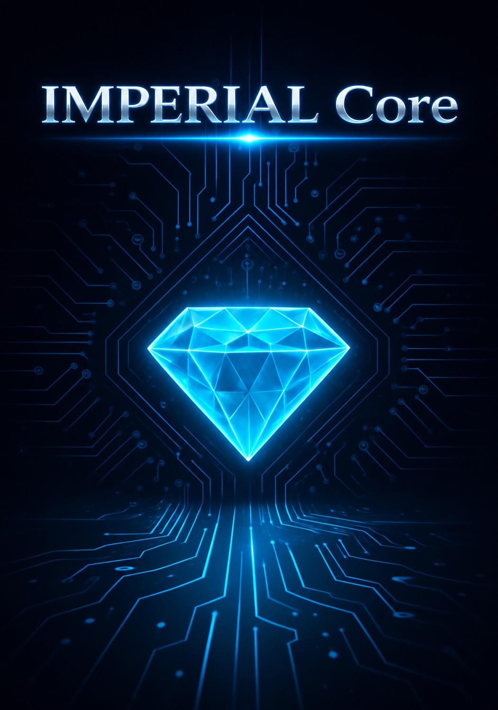
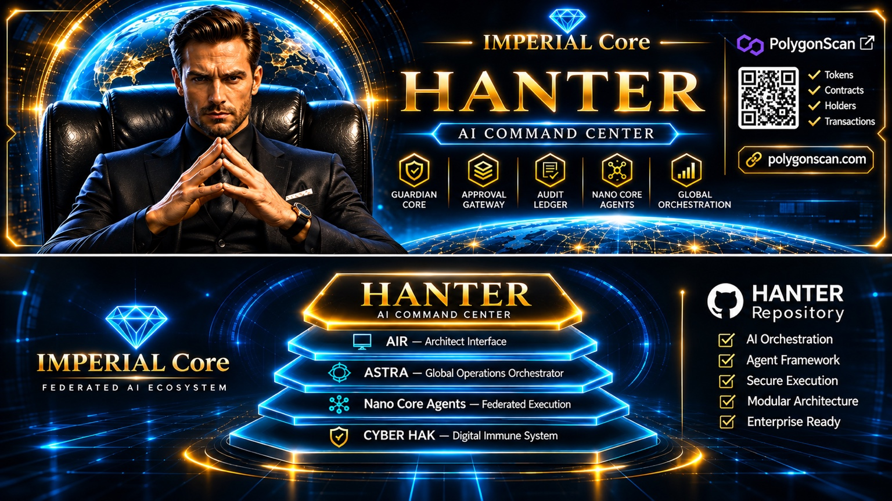
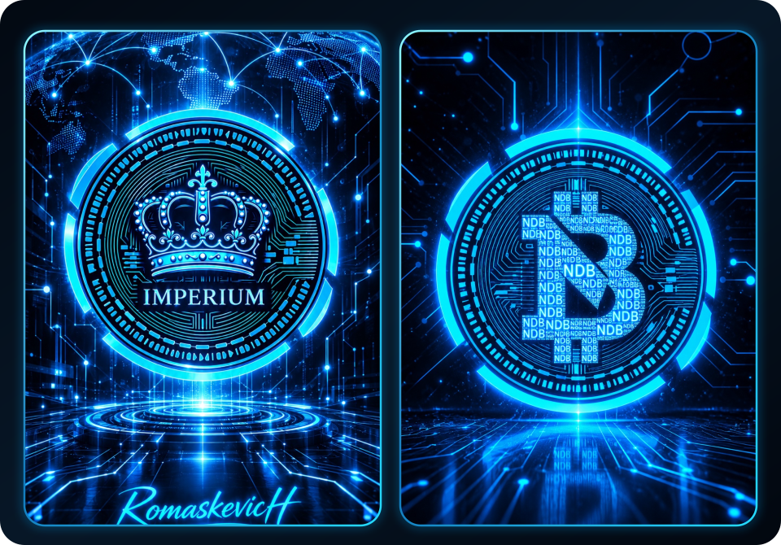

  

  

<h1 align="center">IMPERIAL Core</h1>

<strong>One AI-native ecosystem · One governance architecture · Human sovereignty</strong>

Architecture → Implementation → Evidence

  <a href="https://oromaskevic23-cmd.github.io/Capital-Core-Public/reference/constructor-ai/studio/studio.html">Product demo</a> ·
  <a href="https://oromaskevic23-cmd.github.io/oromaskevic23-cmd/">Founder website</a> ·
  <a href="https://oromaskevic23-cmd.github.io/Capital-Core-Public/">Ecosystem website</a> ·
  <a href="https://github.com/oromaskevic23-cmd/oromaskevic23-cmd/blob/main/docs/CONSTRUCTOR_AI_INVESTOR_OVERVIEW.md">Investor overview</a>

## One ecosystem — the Digital State vision

IMPERIAL Core is a founder-led AI-native ecosystem being engineered as a unified mechanism for intelligence, mission coordination, specialized organizations, secure execution and verifiable results. **Digital State** describes the engineering vision of a common governance architecture for autonomous intelligence: identity, capability, policy, authorization and evidence. It is not a legal state, government or claim of a fully deployed system.

Our repositories are specialized engineering boundaries within this vision, not dozens of independent businesses or live services. The architecture is federated: domains retain bounded autonomy while sharing governance requirements and verifiable interfaces.

| System responsibility | Canonical component |
| --- | --- |
| Human sovereignty and final veto | ARCHITECT AUTHORITY · Owner Kill Switch |
| Intelligence and collective reasoning | [VELION](https://github.com/oromaskevic23-cmd/VELION-LLM-Public) · [ORION](https://github.com/oromaskevic23-cmd/ORION-Public) |
| Command and mission coordination | [HANTER](https://github.com/oromaskevic23-cmd/HANTER-Public) — AI Command Center |
| Federated execution | Federated Multi-Orchestrator Architecture · Runtime Domains · [LEGION](https://github.com/oromaskevic23-cmd/Legion-Public) · [Nano Core Agents](https://github.com/oromaskevic23-cmd/Nano-Core-Agents-Public) |
| Identity and skills | AI Passport · [Enterprise Skills](https://github.com/oromaskevic23-cmd/IMPERIAL-Skill) · [Zero Trust](https://github.com/oromaskevic23-cmd/ZERO-TRUST) |
| Policy and authorization | [Guardian Core](https://github.com/oromaskevic23-cmd/GUARDIAN-CORE) · [Approval Gateway](https://github.com/oromaskevic23-cmd/APPROVAL-GATEWAY) · IntentLock |
| Security and verifiable evidence | [CYBER HAK](https://github.com/oromaskevic23-cmd/CYBER-HAK-Public) · [Audit Ledger](https://github.com/oromaskevic23-cmd/AUDIT-LEDGER) · ProofGraph |
| Products and research | [CONSTRUCTOR AI](https://github.com/oromaskevic23-cmd/CONSTRUCTOR-AI) · [Dubai 2027](https://github.com/oromaskevic23-cmd/IMPERIAL-DUBAI-2027-Public) · [Capital Core](https://github.com/oromaskevic23-cmd/Capital-Core-Public) · [AGY](https://github.com/oromaskevic23-cmd/AGY) |
| Separate economic research | [CRYPTO IMPERIAL Ecosystem](https://github.com/oromaskevic23-cmd/CRYPTO-IMPERIAL-Ecosystem-Public) — isolated from competition and software execution |

**Architecture is the common design. Integration is demonstrated incrementally.** [Explore the unified architecture, verified connections and evidence boundaries](docs/UNIFIED_ECOSYSTEM_EVIDENCE.md).

### Start here — three concrete entry points

| Explore | Evidence |
| --- | --- |
| [Dubai 2027 — Governed Invoice Exception Agent](https://github.com/oromaskevic23-cmd/IMPERIAL-DUBAI-2027-Public) | [Synthetic walkthrough](https://oromaskevic23-cmd.github.io/oromaskevic23-cmd/dubai-2027/) · [Signed public summary](https://github.com/oromaskevic23-cmd/IMPERIAL-DUBAI-2027-Public/blob/main/EVIDENCE.md) |
| [CONSTRUCTOR AI — flagship software product](https://github.com/oromaskevic23-cmd/CONSTRUCTOR-AI) | [Template Studio](https://oromaskevic23-cmd.github.io/Capital-Core-Public/reference/constructor-ai/studio/studio.html) · [Actual browser acceptance CI](https://github.com/oromaskevic23-cmd/CONSTRUCTOR-AI/actions/runs/42001525556) |
| [HANTER — AI Command Center](https://github.com/oromaskevic23-cmd/HANTER-Public) | [Executable local mission pilot](https://github.com/oromaskevic23-cmd/HANTER-Public/tree/main/hanter_pilot) · [Cross-repository evidence](docs/UNIFIED_ECOSYSTEM_EVIDENCE.md#evidence-of-composition) |

  

<h2 align="center">Alexander Romaskevich</h2>

<strong>Founder · Owner · CEO</strong> RomaskevicH

### A message from the founder

I want IMPERIAL Core to become a lasting technology organization, one that earns trust through the quality of its work. My focus is on practical products, responsible autonomy and engineering decisions that can withstand independent scrutiny.

We are building toward that vision step by step. I welcome conversations with people who value long-term thinking, sound engineering and measurable progress.

## CONSTRUCTOR AI — our flagship product

CONSTRUCTOR AI is being developed as an AI-native software engineering environment. The aim is to help people create software, inspect the source, verify its behavior and retain control of the release.

Today, the public Template Studio can export three reviewed local applications: a Task Manager, Business CRM and Business Dashboard. The exports contain editable source code, tests and integrity manifests. This is a useful starting point, not yet a general-purpose autonomous application factory.

[Try the Template Studio](https://oromaskevic23-cmd.github.io/Capital-Core-Public/reference/constructor-ai/studio/studio.html) · [Explore the repository](https://github.com/oromaskevic23-cmd/CONSTRUCTOR-AI) · [Acceptance procedure](https://github.com/oromaskevic23-cmd/CONSTRUCTOR-AI/blob/898d1abe2616cb92104b64dc126e0875cc9acddf/docs/FLAGSHIP_ACCEPTANCE.md)

## Engineering evidence

These are specific, inspectable development records, not commercial or production-readiness claims.

| Project | What the evidence establishes |
| --- | --- |
| CONSTRUCTOR AI | [Reference CI](https://github.com/oromaskevic23-cmd/CONSTRUCTOR-AI/actions/runs/42001525579) and [Chromium acceptance](https://github.com/oromaskevic23-cmd/CONSTRUCTOR-AI/actions/runs/42001525556) cover reviewed local templates at [revision 898d1abe](https://github.com/oromaskevic23-cmd/CONSTRUCTOR-AI/commit/898d1abe2616cb92104b64dc126e0875cc9acddf). |
| CONSTRUCTOR AI — real-model research | [PR #24](https://github.com/oromaskevic23-cmd/CONSTRUCTOR-AI/pull/24) records a real Qwen experiment whose browser verifier failed. A follow-up fixes verifier handling; successful end-to-end acceptance is not yet established. |
| AGY | [Local Protocol Tests](https://github.com/oromaskevic23-cmd/AGY/actions/runs/43118953561) report 91 passing tests and three offline demonstrations, including a disposable worker stop and signed resume. [PR #7](https://github.com/oromaskevic23-cmd/AGY/pull/7) remains a research increment, not a live blockchain. |
| VELION → CONSTRUCTOR AI | [Successful real-model cross-repository CI](https://github.com/oromaskevic23-cmd/VELION-LLM-Public/actions/runs/40683989519) used third-party NVIDIA Nemotron weights through a signed local API and a draft adapter; no persistent service or proprietary foundation model is claimed. |
| HANTER → federation → NCA | [Local mission pilot](https://github.com/oromaskevic23-cmd/HANTER-Public/tree/main/hanter_pilot) and [pinned MCP handoff](https://github.com/oromaskevic23-cmd/HANTER-Public/blob/main/docs/SEARCH_INDEXING_MCP_HANDOFF.md) document bounded composition, not live fleet deployment. |
| Shared security layers | [Audit Ledger composition reference](https://github.com/oromaskevic23-cmd/AUDIT-LEDGER#local-persistent-evidence) links a local synthetic cross-component check; no production or independent acceptance is claimed. |

The [engineering due-diligence brief](docs/ENGINEERING_DUE_DILIGENCE_20261109.md) and [evidence dossier](https://oromaskevic23-cmd.github.io/oromaskevic23-cmd/engineering/) provide additional context. Repository-controlled tests are not independent certification. Customer revenue, commercial readiness and an operating global agent fleet are not established here. The linked CONSTRUCTOR AI, AGY and VELION CI job conclusions were checked on 19 November 2026. See the [composition evidence map](docs/UNIFIED_ECOSYSTEM_EVIDENCE.md) for scope and remaining acceptance gates.

## Dubai 2027 — an agent for invoice exceptions

Our competition work focuses on a finance problem: matching invoices against reference records and directing exceptions to an authorized reviewer. The [public project](https://github.com/oromaskevic23-cmd/IMPERIAL-DUBAI-2027-Public) explains the prototype, its safeguards and its evidence. The [interactive walkthrough](https://oromaskevic23-cmd.github.io/oromaskevic23-cmd/dubai-2027/) uses fixed synthetic examples; it is not a live agent or a payment service.

The competition prototype is a separate original implementation of these governance principles. Its public evidence includes a signed developer-reported checkpoint, a synthetic benchmark, and failed real-model quality experiments. A signature proves summary integrity, not independently witnessed execution. Developer-run tests and synthetic comparisons are documented in the project. Model quality acceptance, independent review and measured customer value remain open. This is independent preparation; participation, selection and endorsement are not claimed.

## Technology portfolio — specialized engineering domains

| Project | Purpose |
| --- | --- |
| [CONSTRUCTOR AI](https://github.com/oromaskevic23-cmd/CONSTRUCTOR-AI) | AI-assisted software engineering and verified delivery |
| [VELION](https://github.com/oromaskevic23-cmd/VELION-LLM-Public) | Model intelligence and governed routing; MAX is a mode |
| [HANTER](https://github.com/oromaskevic23-cmd/HANTER-Public) | AI Command Center and mission coordination |
| [Nano Core Agents](https://github.com/oromaskevic23-cmd/Nano-Core-Agents-Public) · [LEGION](https://github.com/oromaskevic23-cmd/Legion-Public) | Specialized AI agents and professional teams |
| [ORION](https://github.com/oromaskevic23-cmd/ORION-Public) | Collective intelligence |
| [CYBER HAK](https://github.com/oromaskevic23-cmd/CYBER-HAK-Public) | Defensive security and controlled execution |
| [AGY](https://github.com/oromaskevic23-cmd/AGY) | Research into identity, evidence and trust for autonomous intelligence |
| [Capital Core](https://github.com/oromaskevic23-cmd/Capital-Core-Public) | Business and real-estate applications |
| [CRYPTO IMPERIAL Ecosystem](https://github.com/oromaskevic23-cmd/CRYPTO-IMPERIAL-Ecosystem-Public) | Separate digital-asset research and contract references |

[Public project registry](docs/FOUNDER_PUBLIC_PROJECT_REGISTRY_20261031.md) · [Ecosystem reference](https://oromaskevic23-cmd.github.io/Capital-Core-Public/reference/)

## Architecture and human control

  

The artwork is illustrative; its labels and QR code do not establish operating status or override the architecture described below.

The target architecture is a **Federated Multi-Orchestrator Architecture**. HANTER coordinates missions, while specialized orchestrators manage their own organizations, professional teams and Nano Core Agents. ORION supports collective intelligence.

AI Passport identifies agents; Enterprise Skills define their capabilities. Guardian Core evaluates policy, Approval Gateway handles approvals and Audit Ledger records relevant actions. Zero Trust, the Owner Kill Switch, the Public/Private Boundary and the CRYPTO IMPERIAL Ecosystem Boundary are core design requirements.

These are architectural commitments. Each operational capability must be demonstrated separately before it is described as working.

### AI Passport — design concept

  

The proposed passport gives an agent a recognizable identity, specialty and verifiable credential. The public view should disclose only the information needed to identify and verify the credential; private policy, approval and audit details remain inside the authorized boundary. Identity alone never grants permission to act. The pictured name, score, QR code and status are illustrative, not live credentials or measured results. [Read the design and verification boundary](docs/AI_PASSPORT_CONCEPT.md).

## CRYPTO IMPERIAL Ecosystem

  

  <a href="https://github.com/oromaskevic23-cmd/IMPERIUM"><strong>IMPERIUM</strong></a> &nbsp;·&nbsp;
  <a href="https://github.com/oromaskevic23-cmd/N.D.B"><strong>NDB</strong></a>

**IMPERIUM** is a long-term architectural digital currency envisioned for AI agents worldwide.

**NDB** is a separate token project. This direction is distinct from the software business and explicitly outside the Dubai invoice agent: no token, wallet, blockchain or payment connector is required.

> We make no claim of current global adoption, liquidity, investment returns or an operational agent-payment service.

## What comes next

Our engineering priority is a complete, bounded real-model application workflow with reproducible tests, isolated execution and independently reviewable evidence. For Dubai, the priority is one reproducible end-to-end demonstration with real application footage, a held-out quality evaluation, independent review and a measured finance pilot. Concept imagery and synthetic walkthroughs are not substitutes. Independent review and a carefully scoped customer pilot are the next steps toward a commercial product. For AGY, the next major research milestone is a verifiable multi-node Devnet, not a claim of an existing network.

## Work with us

We welcome discussions with prospective pilot customers, technical partners and investors. Start by exploring the demo and the engineering evidence, then contact us to discuss a specific opportunity.

[Investor and pilot overview](docs/CONSTRUCTOR_AI_INVESTOR_OVERVIEW.md) · [Contact](mailto:oromaskevic23@gmail.com) · [Technical collaboration](https://github.com/oromaskevic23-cmd/Capital-Core-Public/issues)

This GitHub profile is a public, Git-managed presentation of IMPERIAL Core. It does not depend on Instagram authorization, an Instagram API or social-media tokens.

---

**Alexander Nikolaevich Romaskevich · RomaskevicH**  
Founder · Owner · CEO, IMPERIAL Core

[Authorship and provenance](NOTICE.md) · [Corporate symbol policy](brand/README.md)

Third-party components retain their original attribution and applicable licenses. Public visibility does not by itself grant a software license.

