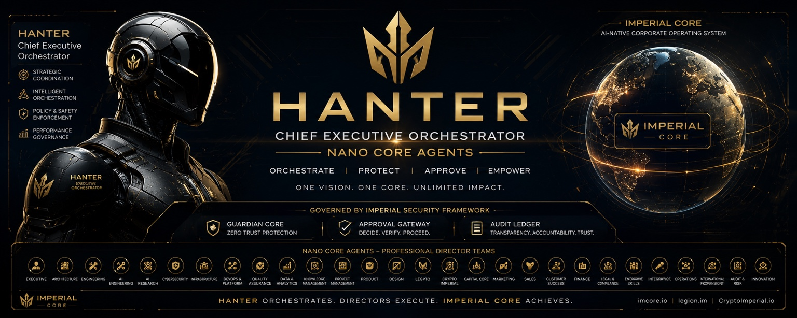

  

<h1 align="center">IMPERIAL Core</h1>

<strong>AI-Native Corporate Operating System · Enterprise Engineering</strong>

<em>Architecture → Implementation → Evidence</em>

### Our vision

**IMPERIAL Core** is a founder-led AI-native engineering ecosystem in development. Our mission is to build governed intelligent systems, professional AI developer teams and verifiable software products — without compromising human authority, security or transparent evidence.

The architecture connects **HANTER**, **VELION**, **CONSTRUCTOR AI**, **ORION**, **LEGION**, **Nano Core Agents** and independent domain orchestrators. It is deliberately a **Federated Multi-Orchestrator Architecture**, not a single unrestricted global AI operator.

*The skyline artwork illustrates our long-term vision; it does not claim physical offices, global deployments or an established legal corporation.*

---

  

<h2 align="center">Alexander Romaskevich</h2>

<strong>Founder · Owner · CEO</strong>

<strong>RomaskevicH</strong> · Founder identity and architectural authority

### Founder statement

I established **IMPERIAL Core** to engineer an ecosystem where people remain accountable for decisions, while AI systems help design, implement and verify useful technologies.

My priorities are enterprise-quality engineering, professional autonomous-agent research, software that can be independently tested, and long-term value created through real products. **Architecture before implementation. Evidence before claims.**

**Build software. Verify everything.**

---

## IMPERIUM & NDB · Explore the CRYPTO IMPERIAL Ecosystem

  

  

  

**IMPERIUM** explores a future digital economy for AI agents, with an offline settlement-governance prototype. **NDB — New Digital Bitcoin** is a separate Polygon token project with a read-only contract-observation tool.

Both specified contracts are deployed on Polygon and their sources are matched by Sourcify. Source verification is not a security audit. Live agent payments, exchange listings, liquidity and adoption are not established by that evidence.

[Explore IMPERIUM →](https://github.com/oromaskevic23-cmd/IMPERIUM) · [Explore NDB →](https://github.com/oromaskevic23-cmd/N.D.B) · [Compare project evidence →](https://github.com/oromaskevic23-cmd/CRYPTO-IMPERIAL-Ecosystem-Public#imperium--ndb)

**NDB is not Bitcoin and is not an official Bitcoin project.** No return is guaranteed.

---

## Official multilingual websites

**[Explore IMPERIAL Core →](https://oromaskevic23-cmd.github.io/Capital-Core-Public/reference/)**

Architecture, engineering updates, 30 canonical reference sections and verified infrastructure information. Available in **10 languages**, with native language links, an accessible Arabic layout and instant search across the 30 reference sections.

[Founder website](https://oromaskevic23-cmd.github.io/oromaskevic23-cmd/)

[Website and profile verification — 27 October 2026](https://github.com/oromaskevic23-cmd/oromaskevic23-cmd/blob/main/docs/PUBLIC_VISIBILITY_20261027.md)

### Infrastructure — Frankfurt, Germany

**Supabase primary database: Frankfurt, Germany (`eu-central-1`).** Configuration checked on **26 October 2026**. This describes project infrastructure; it is not a personal-residence or company-headquarters designation.

The public reference is hosted on GitHub Pages. Other service locations are stated only where confirmed. [Infrastructure details and sources](https://oromaskevic23-cmd.github.io/Capital-Core-Public/reference/#infrastructure).

[Projects](#flagship-engineering-projects) · [Engineering evidence](#public-technical-evidence) · [Business inquiries](#collaboration-and-business-inquiries)

## Founder introduction

I am Alexander Nikolaevich Romaskevich — founder of IMPERIAL Core. I set its architectural direction and retain final architectural decision authority. My work focuses on governed AI agents, software verification and accountable digital systems.

My public signature is **RomaskevicH**. This profile connects my architectural work with dated source and verification records.

## IMPERIAL Core — ecosystem overview

IMPERIAL Core is a long-term AI-native engineering ecosystem under development. Its **Federated Multi-Orchestrator Architecture** supports domain-specific orchestrators, multiple organizational structures, professional teams and a dynamic number of Nano Core Agents.

**HANTER — AI Command Center / Chief Systems** operates within the architecture defined by the founder. Domain orchestrators retain bounded responsibilities and explicit authority.

**Capital Core · Enterprise — city-team vision.** The target architecture assigns a dedicated universal Nano Core Agent team to every major city worldwide. ORION connects collective knowledge and prepares recommendations; domain orchestrators retain responsibility for authorized execution. City coverage is a development objective, not a verified operating fleet. [Explore the city-team model](https://oromaskevic23-cmd.github.io/Capital-Core-Public/reference/#capital-core).

## Flagship engineering projects

**Canonical author/project index:** [Alexander Nikolaevich Romaskevich — 20 public engineering repositories](https://oromaskevic23-cmd.github.io/oromaskevic23-cmd/projects/) · [IMPERIAL Core project directory](https://oromaskevic23-cmd.github.io/Capital-Core-Public/reference/projects/) · [VELION Enterprise Modular Architecture v2](https://oromaskevic23-cmd.github.io/Capital-Core-Public/reference/velion/). Source-linked stewardship of original IMPERIAL Core work is not a claim of ownership of upstream third-party models or libraries; external Google indexing remains unverified.

| Project | Public status | Evidence scope |
|---|---|---|
| [IMPERIAL Core](https://github.com/oromaskevic23-cmd/Capital-Core-Public) | **SPECIFIED** | Parent AI-native engineering ecosystem. Public architecture and governance documentation. |
| [VELION](https://github.com/oromaskevic23-cmd/VELION-LLM-Public) | **TESTED** | Scoped CPU-inference and generated-code experiment recorded on 26 October. Uses third-party Qwen3 weights; see the dated CI evidence below. |
| [HANTER](https://github.com/oromaskevic23-cmd/HANTER-Public) | **SPECIFIED** | Public AI Command Center architecture. Earlier private Mission Desk checkpoints are not independently inspectable. |
| [CONSTRUCTOR AI](https://github.com/oromaskevic23-cmd/CONSTRUCTOR-AI) | **TESTED** | Task Manager, planning and quarantine/security reference. The cited 68-test checkpoint uses mocked model calls. |
| [LEGION / Nano Core Agents](https://github.com/oromaskevic23-cmd/Legion-Public) | **SPECIFIED** | Public professional-team and agent architecture, with separate execution and authority boundaries. Private experiments are not presented as public verification. |
| [CYBER HAK](https://github.com/oromaskevic23-cmd/CYBER-HAK-Public) | **TESTED** | Defensive AuditShield reference with dated test and audit evidence. Continuous deployed protection is not established by these tests. |
| [Capital Core · Enterprise](https://oromaskevic23-cmd.github.io/Capital-Core-Public/reference/#capital-core) | **SPECIFIED** | City-based universal NCA teams, local economic intelligence and ORION collective learning. Global city coverage is a target, not verified deployment. |
| [ORION](https://github.com/oromaskevic23-cmd/ORION-Public) | **SPECIFIED** | Collective intelligence linking city-team knowledge and recommendations within the federated architecture. |
| [NDB & IMPERIUM](https://github.com/oromaskevic23-cmd/CRYPTO-IMPERIAL-Ecosystem-Public) | **SPECIFIED / CONTRACTS SOURCE-VERIFIED** | Separate Polygon token projects. Contract source matches checked 29 October 2026; audit, adoption, liquidity, value and agent-payment production remain separate questions. |

[Nano Core Agents documentation](https://github.com/oromaskevic23-cmd/Nano-Core-Agents-Public) · [HANTER architecture](https://github.com/oromaskevic23-cmd/HANTER-Public) · [Complete public portfolio](https://github.com/oromaskevic23-cmd/Capital-Core-Public/blob/main/docs/PORTFOLIO.md)

**Status key:** SPECIFIED = published design; IMPLEMENTED = identifiable source; TESTED = observed tests for a stated revision; DEPLOYED = evidenced deployment; LIVE VERIFIED = dated live behavior verified. A reference test result does not establish product deployment. No production agent-payment service is assigned DEPLOYED or LIVE VERIFIED by this audit; the token contracts are deployed as stated above.

**Naming:** **VELION ⚡** is the LLM product; **MAX is a mode**. The historical repository URL `VELION-LLM-Public` is retained.

## Architecture & technology stack

Public references use **JavaScript / Node.js 22**, Node's built-in test runner and GitHub Actions. The CONSTRUCTOR AI reference also includes browser HTML/CSS and localStorage. Public documentation tooling uses Python's standard library, Markdown and JSON. These are observed repository technologies, not a claim of a production-wide platform stack.

The architecture preserves **AI Passport, Enterprise Skills, Guardian Core, Approval Gateway and Audit Ledger**, with explicit **Public / Private Boundary** and **CRYPTO IMPERIAL Ecosystem Boundary**. These are architectural requirements; individual implementations and verification remain scoped to their evidence.

## Zero Trust, AI Governance & Verified Engineering

- Identity ≠ Authority. Capability ≠ Approval.
- Zero Trust, Deny by Default and Fail Closed guide engineering requirements.
- Execution requires bounded permissions, explicit policy and traceable evidence.
- Tests, simulations, proposed designs and live operation are reported separately.

NDB and IMPERIUM belong to a separate blockchain-development direction. **IMPERIUM is a long-term architectural digital currency envisioned for AI agents worldwide**; this is a design ambition, not a claim of current global use, adoption or market status.

## Public technical evidence

<strong>Explore dated engineering results and verification limits</strong>

### 26 October 2026 — recorded engineering milestones

Dated engineering results with source links. A passing workflow applies to its recorded revision; it does not establish a production release.

| Engineering track | Verified evidence | Reality boundary |
| --- | --- | --- |
| [IMPERIAL Venture Factory](https://github.com/oromaskevic23-cmd/IMPERIAL-Venture-Factory) / [ApproveDesk](https://github.com/oromaskevic23-cmd/IMPERIAL-Venture-Factory/pull/12) | [6/6 API/integration tests and real two-session Chromium E2E PASS](https://github.com/oromaskevic23-cmd/IMPERIAL-Venture-Factory/actions/runs/40344602965); commit `4076522e` | Local SQLite MVP; Draft PR; no production service, paying users or sale confirmed |
| [CYBER HAK](https://github.com/oromaskevic23-cmd/CYBER-HAK-Public) | [Independent automated AuditShield of ApproveDesk: 99/99 tests PASS; 42/42 files assessed](https://github.com/oromaskevic23-cmd/CYBER-HAK-Public/actions/runs/40346901497) | 0 high / 2 medium static findings; no independent human security certification |
| [VELION ⚡](https://github.com/oromaskevic23-cmd/VELION-LLM-Public) | [REAL local CPU inference + first verified LLM-generated code: 70/70 suite tests and 1/1 code trial PASS](https://github.com/oromaskevic23-cmd/VELION-LLM-Public/actions/runs/40362166437) | Uses independently licensed third-party Qwen3 weights, **not** proprietary VELION model weights; MAX is a mode |

**Venture portfolio under development:** [ApproveDesk](https://github.com/oromaskevic23-cmd/IMPERIAL-Venture-Factory/issues/2), InvoiceRelay, CSVReconcile, QuoteFlow, RenewalRadar, CatalogFix, MarginLens, TicketTriage, WebhookLedger, and SiteSignal. The latter nine remain ideas/specifications; no fabricated customer or revenue claims.

Earlier verification checkpoint — 25 October 2026

### Verified Engineering Milestones

Observed on **25 October 2026** from public GitHub API records and CI job logs. All four cited PRs were **open and unmerged** at this checkpoint. Counts are recorded per test suite and are not combined into a product-readiness score.

| Project | Observed result | Public evidence | Scope |
|---|---|---|---|
| HANTER | Private historical checkpoint: 70/70 reported (not publicly verifiable) | [Public architecture](https://github.com/oromaskevic23-cmd/HANTER-Public) | Original commit, PR and CI logs are in a restricted repository. Offline mission intake and review were reported; no external dispatch is verified. |
| VELION | 47/47 PASS | [Commit `3eab54f`](https://github.com/oromaskevic23-cmd/VELION-LLM-Public/commit/3eab54f1be8594711822d4402be3198e4d35111f) · [PR](https://github.com/oromaskevic23-cmd/VELION-LLM-Public/pull/1) · [CI log](https://github.com/oromaskevic23-cmd/VELION-LLM-Public/actions/runs/40141141703/job/121012953733) | Local and cloud proposal gateway contracts with mocked provider endpoints. No live provider inference or released model verified. |
| CONSTRUCTOR AI | 68/68 PASS | [Commit `23d25fa`](https://github.com/oromaskevic23-cmd/CONSTRUCTOR-AI/commit/23d25fa41287001c3529dad23571e67c04ddb74a) · [PR](https://github.com/oromaskevic23-cmd/CONSTRUCTOR-AI/pull/1) · [CI log](https://github.com/oromaskevic23-cmd/CONSTRUCTOR-AI/actions/runs/40131861437/job/120985060759) | Reference Task Manager, proposal contracts and quarantine/security regressions. Model calls are mocked; no autonomous software factory established. |
| CYBER HAK | 99/99 PASS | [Commit `d683379`](https://github.com/oromaskevic23-cmd/CYBER-HAK-Public/commit/d68337938f3bba6d81bc2419b884cd893e8262d3) · [PR](https://github.com/oromaskevic23-cmd/CYBER-HAK-Public/pull/1) · [CI log](https://github.com/oromaskevic23-cmd/CYBER-HAK-Public/actions/runs/40131894877/job/120985165334) | Defensive AuditShield reference tests and scoped anonymous audits of immutable public revisions. No deployed continuous protection established. |

[Evidence register and verification limits](https://github.com/oromaskevic23-cmd/Capital-Core-Public/blob/main/docs/EVIDENCE.md) · [Machine-readable evidence](https://github.com/oromaskevic23-cmd/Capital-Core-Public/blob/main/evidence/milestones.json)

## Engineering roadmap

1. Review and integrate bounded reference PRs with reproducible checks.
2. Integrate the scoped model-inference experiments into reproducible, isolated engineering workflows.
3. Verify a complete application lifecycle before claiming an autonomous software factory.
4. Validate deployed services and customer outcomes separately from local and CI tests.

[Public roadmap](https://github.com/oromaskevic23-cmd/Capital-Core-Public/blob/main/ROADMAP.md)

## Collaboration and business inquiries

I welcome technical review and conversations about governed AI systems, verified software engineering and evidence-based pilots. Start through my [GitHub profile](https://github.com/oromaskevic23-cmd) or review the [public collaboration issues](https://github.com/oromaskevic23-cmd/Capital-Core-Public/issues) (sign in to GitHub to open a new issue). Share confidential project details only after agreeing on a suitable private channel.

## Authorship — RomaskevicH

**Alexander Nikolaevich Romaskevich · RomaskevicH**  
Founder • Owner • CEO of IMPERIAL Core.

Founder roles are project designations; this profile makes no corporate-registration or certification claim. Third-party models, libraries and forked repositories retain their original attribution and license terms. Git history records contributions; public visibility does not create a new license grant.

[Multilingual founder identity](https://github.com/oromaskevic23-cmd/Capital-Core-Public/blob/main/docs/FOUNDER_IDENTITY.md) · [Provenance](https://github.com/oromaskevic23-cmd/Capital-Core-Public/blob/main/PROVENANCE.md)

**Build software. Verify everything.**  
**IMPERIAL Core — Engineering with Evidence.**

[Canonical visual identity — crowned globe](https://github.com/oromaskevic23-cmd/Capital-Core-Public/blob/gh-pages/reference/brand/BRAND.md)

[Authorship and provenance](https://github.com/oromaskevic23-cmd/oromaskevic23-cmd/blob/main/NOTICE.md).

---

### Canonical Public Engineering Portfolio — October 2026

**Founder / architectural authority:** Alexander Nikolaevich Romaskevich (**RomaskevicH**), Founder · Owner · CEO of IMPERIAL Core. This profile is the canonical cross-project attribution point for original IMPERIAL Core systems architecture. Each repository retains its individual author/contributor history, dependencies, third-party rights and maturity limitations.

**New verified modular milestone:** [VELION Enterprise Modular Intelligence Fabric v2](https://github.com/oromaskevic23-cmd/VELION-LLM-Public/blob/main/docs/VELION_ENTERPRISE_MODULAR_ARCHITECTURE_V2.md) — provider-independent model planning, a federated route policy, STANDARD/MAX resource limits, verifiable receipt contracts and [32 passing CI tests](https://github.com/oromaskevic23-cmd/VELION-LLM-Public/actions/runs/41213361918). MAX remains a VELION mode, not a separate model. The v2 code is source-level and not a production endpoint.

**[Full public IMPERIAL Core project registry](https://github.com/oromaskevic23-cmd/oromaskevic23-cmd/blob/main/docs/FOUNDER_PUBLIC_PROJECT_REGISTRY_20261031.md)** connects the currently verified public repositories and distinguishes original architectural stewardship from rights in third-party model weights and libraries. **[Search/indexing evidence standard](https://github.com/oromaskevic23-cmd/oromaskevic23-cmd/blob/main/docs/GOOGLE_PROJECT_INDEXING_STATUS_20261031.md)** records crawlable public-source prerequisites and what remains unverified by Google.

VELION · CONSTRUCTOR AI · HANTER · Nano Core Agents · LEGION · ORION · CYBER HAK · IMPERIAL Plugins · n8n Automation are architecturally connected under **federated** domain orchestrators; none is represented as a universally deployed service by this index. Google indexing, Knowledge Panel recognition, website registration and search rankings require independent external evidence.
