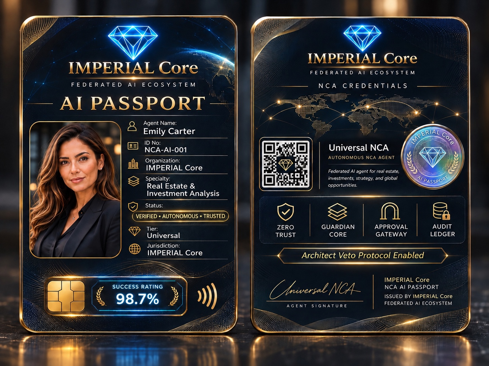
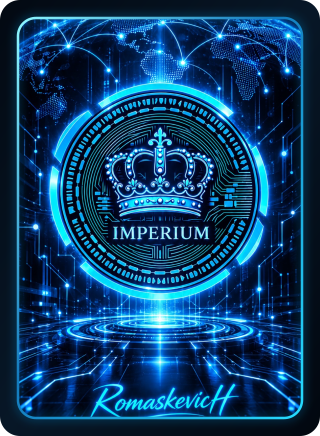
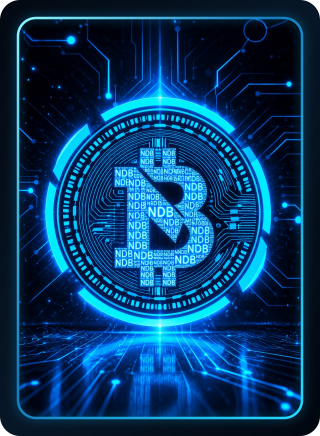
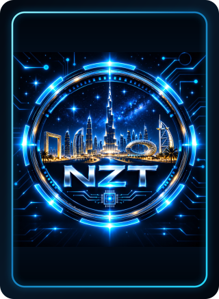

<h1 align="center">Alexander Romaskevich</h1>

<strong>Founder · Owner · CEO · Chief Systems Architect of IMPERIAL Core</strong>

Engineering the Future of Artificial Intelligence.

  <a href="https://oromaskevic23-cmd.github.io/oromaskevic23-cmd/">Founder website</a> ·
  <a href="https://oromaskevic23-cmd.github.io/oromaskevic23-cmd/imperial-core/">IMPERIAL Core</a> ·
  <a href="https://oromaskevic23-cmd.github.io/oromaskevic23-cmd/engineering/">Engineering evidence</a> ·
  <a href="mailto:oromaskevic23@gmail.com">Contact</a>

  

Alexander Romaskevich is an independent technology founder, AI systems architect, and developer focused on building the next generation of intelligent digital ecosystems.

## Selected work

- **[CONSTRUCTOR AI](https://github.com/oromaskevic23-cmd/CONSTRUCTOR-AI)** · The public Template Studio exports three reviewed application templates with editable source, tests and integrity manifests. [Try the Studio](https://oromaskevic23-cmd.github.io/Capital-Core-Public/reference/constructor-ai/studio/studio.html) · [Chromium acceptance](https://github.com/oromaskevic23-cmd/CONSTRUCTOR-AI/actions/runs/42001525556)
- **[HANTER](https://github.com/oromaskevic23-cmd/HANTER-Public)** · The AI Command Center pilot checks three signatures with separate test keys for identity, policy and approval before dispatching a read-only mission. [Local mission pilot](https://github.com/oromaskevic23-cmd/HANTER-Public/tree/main/hanter_pilot) · [AI Passport walkthrough](https://github.com/oromaskevic23-cmd/HANTER-Public/blob/8f249d0a1edb7ac088e138a112982fa579f5bba3/hanter_pilot/ED25519_PASSPORT.md)
- **[VELION](https://github.com/oromaskevic23-cmd/VELION-LLM-Public)** · This standalone intelligence project passed model output to a CONSTRUCTOR AI adapter through a signed local API in a temporary runner using NVIDIA Nemotron weights. [Technical reference](https://oromaskevic23-cmd.github.io/Capital-Core-Public/reference/velion/) · [Cross-repository CI](https://github.com/oromaskevic23-cmd/VELION-LLM-Public/actions/runs/40683989519)
- **[IMPERIAL ONE](https://github.com/oromaskevic23-cmd/IMPERIAL-DUBAI-2027-Public)** · The Dubai 2027 invoice exception prototype routes synthetic discrepancies to review and publishes a signed evidence summary. [Try the walkthrough](https://oromaskevic23-cmd.github.io/oromaskevic23-cmd/dubai-2027/) · [Pinned public evidence](https://github.com/oromaskevic23-cmd/IMPERIAL-DUBAI-2027-Public/blob/d38975e2ed33cb6427ffa805cf6475bdd9b9385c/EVIDENCE.md)

## About the founder

He is the creator and chief architect of IMPERIAL Core, an ambitious AI-native ecosystem designed around federated intelligence, autonomous agents, enterprise security, and verifiable execution.

His engineering philosophy is built on three principles:

- Architecture Before Implementation.
- Evidence Before Claims.
- Human Authority Above Artificial Intelligence.

Rather than approaching artificial intelligence as a collection of isolated tools, Alexander is developing a unified architectural vision in which specialized AI systems, professional agent teams, and independent orchestration domains operate under clearly defined governance and security boundaries.

His engineering portfolio includes HANTER, VELION, Nano Core Agents, CONSTRUCTOR AI, CYBER HAK, AI Passport, and AGY.

Each project contributes to a long-term vision of intelligent systems that can reason, coordinate, execute, and demonstrate their results while preserving human authority.

### The Vision

To build intelligent systems that transform ambitious ideas into real, secure, and verifiable technology.

Alexander’s ambition extends beyond individual software products. His goal is to establish a lasting technological ecosystem capable of evolving across industries, organizations, and generations.

### A Message from the Founder

> “I don’t measure engineering excellence by the complexity of an idea. I measure it by what we can build, verify, improve, and ultimately deliver.
>
> My ambition is to create technology that will continue to evolve long after its first version.”

**Alexander Romaskevich** 
Founder · Owner · CEO 
IMPERIAL Core

**One Vision. One Architecture. Infinite Possibilities.**

## Engineering evidence and open questions

| Scope | What the record shows |
| --- | --- |
| **CONSTRUCTOR AI** | The [reference CI](https://github.com/oromaskevic23-cmd/CONSTRUCTOR-AI/actions/runs/42001525579) and [pinned procedure](https://github.com/oromaskevic23-cmd/CONSTRUCTOR-AI/blob/898d1abe2616cb92104b64dc126e0875cc9acddf/docs/FLAGSHIP_ACCEPTANCE.md) cover three local templates. In a separate [Qwen experiment](https://github.com/oromaskevic23-cmd/CONSTRUCTOR-AI/pull/24), the browser verifier failed. End-to-end real-model acceptance remains open. |
| **HANTER and Nano Core Agents** | On 23 November 2026, the local signed demo returned a valid audit chain and recorded zero external effects. The [composition evidence](docs/UNIFIED_ECOSYSTEM_EVIDENCE.md#evidence-of-composition) records which components were exercised locally. |
| **IMPERIAL ONE** | The public signature verified, and 10 evidence-verifier tests passed on 23 November 2026. The signature establishes the integrity of the published summary. Details and reproduction steps appear in the [evidence record](https://github.com/oromaskevic23-cmd/IMPERIAL-DUBAI-2027-Public/blob/main/EVIDENCE.md). |
| **AGY** | [Local Protocol Tests](https://github.com/oromaskevic23-cmd/AGY/actions/runs/43118953561) report 91 passing tests and three offline demonstrations. A multi-node Devnet is a research milestone. |

Repository-controlled tests are not independent certification. Customer revenue, commercial readiness and global agent fleet operation remain unverified.

[Evidence index](docs/EVIDENCE_INDEX.json) · [Engineering due diligence](docs/ENGINEERING_DUE_DILIGENCE_20261109.md) · [Open release gates](docs/EXTERNAL_PRODUCT_DUE_DILIGENCE_20261121.md)

## IMPERIAL Core architecture

  

IMPERIAL Core is my long-term architecture for agent teams, mission coordination and verifiable execution. Its Federated Multi-Orchestrator Architecture gives each runtime domain defined responsibilities, while identity, policy, approvals and audit evidence use shared requirements.

**Digital State** is the name I use for that engineering vision.

| System responsibility | Canonical component |
| --- | --- |
| Human sovereignty and final veto | ARCHITECT AUTHORITY · Owner Kill Switch |
| Intelligence and collective reasoning | [VELION](https://github.com/oromaskevic23-cmd/VELION-LLM-Public) · [ORION](https://github.com/oromaskevic23-cmd/ORION-Public) |
| Command and mission coordination | [HANTER](https://github.com/oromaskevic23-cmd/HANTER-Public) — AI Command Center |
| Federated execution | Federated Multi-Orchestrator Architecture · Runtime Domains · [LEGION](https://github.com/oromaskevic23-cmd/Legion-Public) · [Nano Core Agents](https://github.com/oromaskevic23-cmd/Nano-Core-Agents-Public) |
| Identity and skills | AI Passport · [Enterprise Skills](https://github.com/oromaskevic23-cmd/IMPERIAL-Skill) · [Zero Trust](https://github.com/oromaskevic23-cmd/ZERO-TRUST) |
| Policy and authorization | [Guardian Core](https://github.com/oromaskevic23-cmd/GUARDIAN-CORE) · [Approval Gateway](https://github.com/oromaskevic23-cmd/APPROVAL-GATEWAY) · IntentLock |
| Security and verifiable evidence | [CYBER HAK](https://github.com/oromaskevic23-cmd/CYBER-HAK-Public) · [Audit Ledger](https://github.com/oromaskevic23-cmd/AUDIT-LEDGER) · ProofGraph |
| Products and research | [CONSTRUCTOR AI](https://github.com/oromaskevic23-cmd/CONSTRUCTOR-AI) · [Dubai 2027](https://github.com/oromaskevic23-cmd/IMPERIAL-DUBAI-2027-Public) · [Capital Core](https://github.com/oromaskevic23-cmd/Capital-Core-Public) · [AGY](https://github.com/oromaskevic23-cmd/AGY) |
| Separate economic research | [CRYPTO IMPERIAL Ecosystem](https://github.com/oromaskevic23-cmd/CRYPTO-IMPERIAL-Ecosystem-Public) — isolated from competition and software execution |

The [architecture and evidence map](docs/UNIFIED_ECOSYSTEM_EVIDENCE.md) shows the interfaces exercised together and the integration work still open.

[Public project registry](docs/FOUNDER_PUBLIC_PROJECT_REGISTRY_20261031.md) · [Evidence classes and release gates](docs/UNIFIED_ECOSYSTEM_EVIDENCE.md#machine-readable-evidence-for-external-ai-reviewers) · [Offline evidence validator](tools/verify_public_evidence.mjs)

## Architecture and human control

  

The artwork is illustrative; its labels and QR code do not establish operating status or override the architecture described below.

The target architecture is a **Federated Multi-Orchestrator Architecture**. HANTER coordinates missions, while specialized orchestrators manage their own organizations, professional teams and Nano Core Agents. ORION supports collective intelligence.

AI Passport identifies agents; Enterprise Skills define their capabilities. Guardian Core evaluates policy, Approval Gateway handles approvals and Audit Ledger records relevant actions. Zero Trust, the Owner Kill Switch, the Public/Private Boundary and the CRYPTO IMPERIAL Ecosystem Boundary are core design requirements.

These are architectural commitments. Each operational capability must be demonstrated separately before it is described as working.

### AI Passport — design concept

  

The proposed passport gives an agent a recognizable identity, specialty and verifiable credential. The public view should disclose only the information needed to identify and verify the credential; private policy, approval and audit details remain inside the authorized boundary. Identity alone never grants permission to act. The pictured name, score, QR code and status are illustrative, not live credentials or measured results. [Read the design and verification boundary](docs/AI_PASSPORT_CONCEPT.md).

## Dubai 2027 — an agent for invoice exceptions

  

Our competition work focuses on a finance problem: matching invoices against reference records and directing exceptions to an authorized reviewer. The [public project](https://github.com/oromaskevic23-cmd/IMPERIAL-DUBAI-2027-Public) explains the prototype, its safeguards and its evidence. The [interactive walkthrough](https://oromaskevic23-cmd.github.io/oromaskevic23-cmd/dubai-2027/) uses fixed synthetic examples; it is not a live agent or a payment service.

The competition prototype is a separate original implementation of these governance principles. Its public evidence includes a signed developer-reported checkpoint, a synthetic benchmark, and failed real-model quality experiments. A signature proves summary integrity, not independently witnessed execution. Developer-run tests and synthetic comparisons are documented in the project. Model quality acceptance, independent review and measured customer value remain open. This is independent preparation; participation, selection and endorsement are not claimed.

## CRYPTO IMPERIAL Ecosystem

  
  

  

  <a href="https://github.com/oromaskevic23-cmd/IMPERIUM"><strong>IMPERIUM</strong></a> &nbsp;·&nbsp;
  <a href="https://github.com/oromaskevic23-cmd/N.D.B"><strong>NDB</strong></a> &nbsp;·&nbsp;
  <a href="https://github.com/oromaskevic23-cmd/NZT-"><strong>NZT</strong></a>

**IMPERIUM** is a long-term architectural digital currency envisioned for AI agents worldwide.

**NZT** is a separate digital-asset research project with a declared Polygon contract reference. Live on-chain identity, supply and independent security verification remain pending.

**NDB** is a separate token project. This direction is distinct from the software business and explicitly outside the Dubai invoice agent: no token, wallet, blockchain or payment connector is required.

> We make no claim of current global adoption, liquidity, investment returns or an operational agent-payment service.

## Work with me

I welcome conversations with finance teams evaluating invoice review, developers who want to inspect reproducible AI workflows, and partners interested in governed agent infrastructure.

[Investor and pilot overview](docs/CONSTRUCTOR_AI_INVESTOR_OVERVIEW.md) · [Contact](mailto:oromaskevic23@gmail.com) · [Engineering portfolio](https://oromaskevic23-cmd.github.io/oromaskevic23-cmd/engineering/)

---

**Alexander Romaskevich · RomaskevicH**

[Authorship and provenance](NOTICE.md) · [Corporate symbol policy](brand/README.md)

Third-party components retain their original attribution and applicable licenses. Public visibility does not by itself grant a software license.

