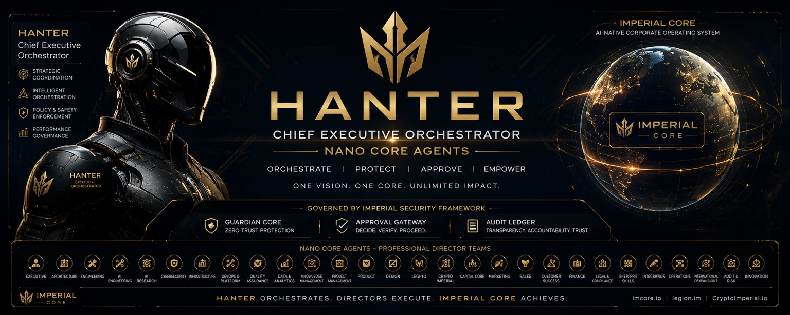

<p align="center">
  
</p>

<p align="center">
  
</p>

<h1 align="center">IMPERIAL Core</h1>
<p align="center"><strong>Inspectable software · Governed AI agents · Evidence-first engineering</strong></p>
<p align="center"><em>Architecture → Implementation → Evidence</em></p>

<p align="center">
  <a href="https://oromaskevic23-cmd.github.io/Capital-Core-Public/reference/constructor-ai/studio/studio.html">Try the product demo</a> ·
  <a href="https://github.com/oromaskevic23-cmd/CONSTRUCTOR-AI">Inspect source &amp; tests</a> ·
  <a href="https://github.com/oromaskevic23-cmd/oromaskevic23-cmd/blob/main/docs/ENGINEERING_DUE_DILIGENCE_20261109.md">Evidence &amp; limitations</a> ·
  <a href="https://github.com/oromaskevic23-cmd/oromaskevic23-cmd/blob/main/docs/CONSTRUCTOR_AI_INVESTOR_OVERVIEW.md">Investor &amp; pilot overview</a> ·
  <a href="mailto:oromaskevic23@gmail.com">Contact</a>
</p>

### Our vision

**IMPERIAL Core** is a founder-led technology ecosystem under development. **CONSTRUCTOR AI is the flagship product**; HANTER, VELION, Nano Core Agents and the security layers form its longer-term engineering context. Our priority is software that people can inspect, test and control.

**Start with evidence, not promises.** A public Template Studio demonstration exports three local applications. The [source](https://github.com/oromaskevic23-cmd/CONSTRUCTOR-AI), [recorded tests](https://github.com/oromaskevic23-cmd/CONSTRUCTOR-AI/actions/runs/42001525579), and [Chromium acceptance workflow](https://github.com/oromaskevic23-cmd/CONSTRUCTOR-AI/actions/runs/42001525556) can be inspected. Production-grade autonomous app generation, customer deployments and commercial traction are **not established by these results**. The [due diligence brief](https://github.com/oromaskevic23-cmd/oromaskevic23-cmd/blob/main/docs/ENGINEERING_DUE_DILIGENCE_20261109.md) separates verified scope from remaining milestones.

---

<p align="center">
  
</p>

<h2 align="center">Alexander Romaskevich</h2>
<p align="center"><strong>Founder · Owner · CEO</strong></p>
<p align="center"><strong>RomaskevicH</strong></p>

### Founder statement

I am **Alexander Nikolaevich Romaskevich**, founder of IMPERIAL Core. I lead the architecture, set the engineering priorities and retain final architectural decision authority. The standard is simple: build useful systems, demonstrate what works and keep decisions accountable.

**Build software. Verify everything. Keep humans in control.**

---

## Investment and pilot partnerships

We welcome inquiries from **pre-seed investors, technical partners and prospective pilot customers** interested in inspectable software creation and evidence-backed engineering. This is an invitation to discuss a pilot, **not a claim of signed investors, customers, contracts or revenue**.

The current prototype exports local applications from predefined templates. A real-model application workflow, multi-user production hosting and customer acceptance remain development milestones. Pilot scope, access, ownership and funding terms must be agreed separately. Start with the demo and reproducible verification steps below.

[Investor & pilot overview](https://github.com/oromaskevic23-cmd/oromaskevic23-cmd/blob/main/docs/CONSTRUCTOR_AI_INVESTOR_OVERVIEW.md) · [Evidence for reviewers](https://github.com/oromaskevic23-cmd/oromaskevic23-cmd/blob/main/docs/ENGINEERING_DUE_DILIGENCE_20261109.md) · [Open the demo](https://oromaskevic23-cmd.github.io/Capital-Core-Public/reference/constructor-ai/studio/studio.html) · [Contact](mailto:oromaskevic23@gmail.com)

## Featured product — CONSTRUCTOR AI

**What an independent visitor can evaluate today:** Template Studio exports three **local, single-user** applications: Task Manager, Business CRM and Business Dashboard. Each includes editable code, automated tests, integrity checks and local browser storage with JSON backup and restore.

**Why this matters:** a reviewer can inspect a generated ZIP, verify file hashes, run its tests, and explore local CRUD and backup/restore behavior. No login, payment or confidential customer dataset is needed for that evaluation. These are reviewed templates, **not** proof that arbitrary prompts produce ready-to-deploy software.

**Verified revision:** On 5 November 2026, the project-controlled [reference CI](https://github.com/oromaskevic23-cmd/CONSTRUCTOR-AI/actions/runs/42001525579) and [real Chromium acceptance](https://github.com/oromaskevic23-cmd/CONSTRUCTOR-AI/actions/runs/42001525556) completed successfully for commit [`898d1abe`](https://github.com/oromaskevic23-cmd/CONSTRUCTOR-AI/commit/898d1abe2616cb92104b64dc126e0875cc9acddf). The checks cover the reviewed templates and exported applications; they do not establish a production service or external certification.

**Reproduce this revision** with Node.js 22+, npm and unzip:

```sh
git clone https://github.com/oromaskevic23-cmd/CONSTRUCTOR-AI.git
cd CONSTRUCTOR-AI
git checkout 898d1abe2616cb92104b64dc126e0875cc9acddf
npm ci --ignore-scripts --no-audit --no-fund
npm run verify
node tools/build-acceptance.mjs acceptance-output
node tools/verify-acceptance.mjs acceptance-output
```

[Source and instructions](https://github.com/oromaskevic23-cmd/CONSTRUCTOR-AI) · [Acceptance procedure and limitations](https://github.com/oromaskevic23-cmd/CONSTRUCTOR-AI/blob/898d1abe2616cb92104b64dc126e0875cc9acddf/docs/FLAGSHIP_ACCEPTANCE.md) · [Product blueprint](https://github.com/oromaskevic23-cmd/CONSTRUCTOR-AI/blob/main/docs/ENTERPRISE_PRODUCT_BLUEPRINT_20261105.md)

The demonstrated scope is a tested local prototype, not arbitrary prompt-to-production app generation. Independent human security review and commercial readiness are not established. Human visual/accessibility review and full cross-browser acceptance remain separate.

## Public engineering portfolio

**Product first, platform second.** These repositories describe the supporting engineering stack and adjacent research. The flagship product is CONSTRUCTOR AI. Architecture documentation describes intended capabilities; individual prototypes demonstrate only their recorded tests. There is no implied 24/7 global agent fleet, security certification or commercial service.

| Project | Focus | Public scope |
|---|---|---|
| [CONSTRUCTOR AI](https://github.com/oromaskevic23-cmd/CONSTRUCTOR-AI) | Inspectable software creation | Tested local prototype |
| [VELION](https://github.com/oromaskevic23-cmd/VELION-LLM-Public) | Model intelligence and governed routing | Architecture and bounded experiments; MAX is a mode |
| [HANTER](https://github.com/oromaskevic23-cmd/HANTER-Public) | AI Command Center | Public architecture and mission-coordination design |
| [Nano Core Agents](https://github.com/oromaskevic23-cmd/Nano-Core-Agents-Public) · [LEGION](https://github.com/oromaskevic23-cmd/Legion-Public) | Professional agents and teams | Architecture and scoped references |
| [ORION](https://github.com/oromaskevic23-cmd/ORION-Public) | Collective intelligence | Public architecture |
| [CYBER HAK](https://github.com/oromaskevic23-cmd/CYBER-HAK-Public) | Defensive security engineering | Reference implementation and tests |
| [Capital Core](https://github.com/oromaskevic23-cmd/Capital-Core-Public) | Business and real-estate applications | Public architecture and reference site |
| [IMPERIUM & NDB](https://github.com/oromaskevic23-cmd/CRYPTO-IMPERIAL-Ecosystem-Public) | Separate blockchain direction | Project documentation and contract references |

[Full project registry](https://github.com/oromaskevic23-cmd/oromaskevic23-cmd/blob/main/docs/FOUNDER_PUBLIC_PROJECT_REGISTRY_20261031.md) · [Engineering evidence dossier](https://oromaskevic23-cmd.github.io/oromaskevic23-cmd/engineering/) · [Founder website](https://oromaskevic23-cmd.github.io/oromaskevic23-cmd/) · [IMPERIAL Core reference](https://oromaskevic23-cmd.github.io/Capital-Core-Public/reference/)

## Architecture and governance

IMPERIAL Core uses a **Federated Multi-Orchestrator Architecture**. HANTER coordinates missions; specialized orchestrators manage their respective teams and Nano Core Agents. ORION provides collective intelligence. This is the target architecture; individual runtime capabilities require their own evidence.

Governance is built around **AI Passport**, **Enterprise Skills**, **Guardian Core**, **Approval Gateway** and **Audit Ledger**, with **Zero Trust**, the **Public / Private Boundary** and the **CRYPTO IMPERIAL Ecosystem Boundary**. Design authority, access approval and execution remain separate.

## CRYPTO IMPERIAL Ecosystem

<p align="center">
  <a href="https://github.com/oromaskevic23-cmd/IMPERIUM"></a>
</p>

<p align="center">
  <a href="https://github.com/oromaskevic23-cmd/HANTER-Public"></a>
</p>

<p align="center">
  <a href="https://github.com/oromaskevic23-cmd/N.D.B"></a>
</p>

**IMPERIUM** is a long-term architectural digital currency envisioned for AI agents worldwide. **NDB** is a separate token project. These initiatives are separate from CONSTRUCTOR AI; no current global adoption, liquidity, financial return or agent-payment service is claimed here.

[IMPERIUM](https://github.com/oromaskevic23-cmd/IMPERIUM) · [NDB](https://github.com/oromaskevic23-cmd/N.D.B) · [Ecosystem documentation](https://github.com/oromaskevic23-cmd/CRYPTO-IMPERIAL-Ecosystem-Public)

## Engineering roadmap

1. **Engineering acceptance:** deliver one complete bounded real-model workflow with isolated execution and independently reviewable QA evidence.
2. **Independent review:** obtain human code/security review and close the documented acceptance findings.
3. **Market validation:** invite a prospective customer to a written-scope, low-risk pilot; record acceptance or rejection instead of assuming demand.
4. **Production decision:** validate multi-user requirements, deployment reliability, support and operating costs before any commercial readiness claim.

## Collaboration and authorship

For investment, pilot or technical collaboration, contact [oromaskevic23@gmail.com](mailto:oromaskevic23@gmail.com) or use the [public collaboration issues](https://github.com/oromaskevic23-cmd/Capital-Core-Public/issues). Please keep confidential details out of public issues.

**Alexander Nikolaevich Romaskevich · RomaskevicH**  
Founder · Owner · CEO, IMPERIAL Core.

Third-party models, libraries and contributions retain their original attribution and applicable licenses. Git history records contributions; public visibility alone does not grant a software license. [Authorship and provenance](https://github.com/oromaskevic23-cmd/oromaskevic23-cmd/blob/main/NOTICE.md) · [Corporate symbol policy](https://github.com/oromaskevic23-cmd/oromaskevic23-cmd/blob/main/brand/README.md).
