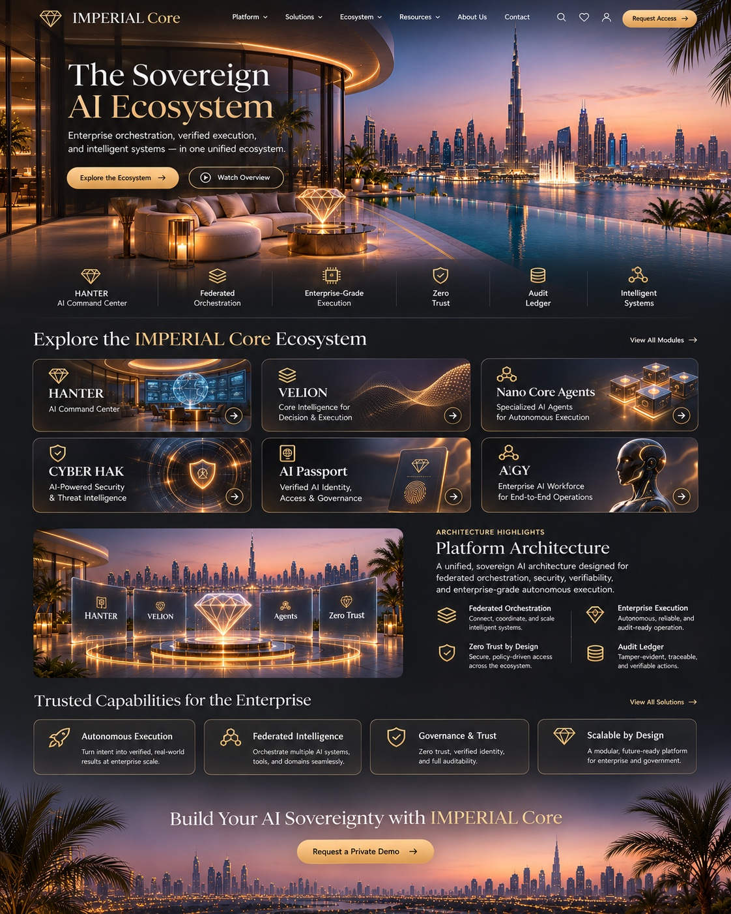

<h1 align="center">Alexander Romaskevich</h1>
<p align="center"><strong>Founder · Owner · CEO · Chief Systems Architect of IMPERIAL Core</strong></p>

I design AI systems for people who need to see what an agent did, who authorized it, and how to check the result. In IMPERIAL Core, that work ranges from exporting a small business app with its tests to tracing the decision to hold an invoice for human review.

<p align="center">
  <a href="https://oromaskevic23-cmd.github.io/Capital-Core-Public/reference/constructor-ai/studio/studio.html"><strong>Open Template Studio</strong></a> ·
  <a href="https://oromaskevic23-cmd.github.io/oromaskevic23-cmd/dubai-2027/#walkthrough"><strong>Explore an invoice case</strong></a> ·
  <a href="https://oromaskevic23-cmd.github.io/oromaskevic23-cmd/">Founder website</a>
</p>

<p align="center">
  <a href="https://oromaskevic23-cmd.github.io/oromaskevic23-cmd/"></a>
</p>

## Selected work

### CONSTRUCTOR AI · Export a working app

Choose **Business CRM** in Template Studio, give the project a name, and download the ZIP. It includes editable source, tests and a manifest of file hashes. The same workflow supports a Task Manager and a Business Dashboard. The reference CI checks the exports, and a separate Chromium run exercises them in a browser. [Source and acceptance procedure](https://github.com/oromaskevic23-cmd/CONSTRUCTOR-AI/blob/898d1abe2616cb92104b64dc126e0875cc9acddf/docs/FLAGSHIP_ACCEPTANCE.md) · [Reference CI](https://github.com/oromaskevic23-cmd/CONSTRUCTOR-AI/actions/runs/42001525579) · [Chromium run](https://github.com/oromaskevic23-cmd/CONSTRUCTOR-AI/actions/runs/42001525556)

### IMPERIAL ONE · Decide when an invoice needs a person

In the Dubai 2027 walkthrough, select **Invoice exception**. The invoice exceeds its purchase order and the supplier's bank details have changed. The case goes to a reviewer, and no payment is sent. The walkthrough uses fixed synthetic examples and is not a live agent. [Public project](https://github.com/oromaskevic23-cmd/IMPERIAL-DUBAI-2027-Public) · [Verify the signed summary in your browser](https://oromaskevic23-cmd.github.io/oromaskevic23-cmd/dubai-2027/#verification)

<details>
<summary><strong>Reproduce the invoice evidence check locally</strong></summary>

From the root of the [published source revision](https://github.com/oromaskevic23-cmd/IMPERIAL-DUBAI-2027-Public/tree/d38975e2ed33cb6427ffa805cf6475bdd9b9385c), run these commands with Node.js 22 or later. No API key or package installation is required.

```sh
node evidence/verify-cli.mjs
node --test evidence/verify.test.mjs
```

The first command verifies the signature on the published summary. The second runs 10 tests, including a changed checkpoint and an unrelated signing key. To see how the model itself performed, open the separate evaluation. On 24 synthetic cases, Qwen recommended a match every time and got 12 right. The rules had access to precomputed discrepancy flags. Model quality acceptance, independent review and measured customer value remain open. [Signed checkpoint and verification guide](https://github.com/oromaskevic23-cmd/IMPERIAL-DUBAI-2027-Public/blob/d38975e2ed33cb6427ffa805cf6475bdd9b9385c/EVIDENCE.md) · [Model evaluation](https://github.com/oromaskevic23-cmd/IMPERIAL-DUBAI-2027-Public/blob/d38975e2ed33cb6427ffa805cf6475bdd9b9385c/REAL_MODEL_RESULTS.md)

</details>

### HANTER · Follow one authorized agent task

HANTER is the AI Command Center. In its local pilot, a Nano Core Agent hashes a 51-byte file. Before it starts, the pilot verifies three signatures covering the agent's identity, the policy decision and the approval. The demo returns the file's SHA-256 digest and the audit-chain check alongside its count of external effects. [Run the signed mission](https://github.com/oromaskevic23-cmd/HANTER-Public/blob/8f249d0a1edb7ac088e138a112982fa579f5bba3/hanter_pilot/ED25519_PASSPORT.md) · [Read the pilot source](https://github.com/oromaskevic23-cmd/HANTER-Public/tree/8f249d0a1edb7ac088e138a112982fa579f5bba3/hanter_pilot)

### VELION · Trace a model response into CONSTRUCTOR AI

VELION is the intelligence core. In a recorded CPU run, a CONSTRUCTOR AI adapter received output from NVIDIA Nemotron through VELION's signed local API. VELION also has a standalone conversation prototype that can use a separately installed local model. [Inspect the integration run](https://github.com/oromaskevic23-cmd/VELION-LLM-Public/actions/runs/40683989519) · [Run local chat](https://github.com/oromaskevic23-cmd/VELION-LLM-Public/tree/main/apps/velion-chat)

## How I evaluate the work

I publish failed experiments alongside successful runs. In a separate CONSTRUCTOR AI experiment with Qwen-generated code, the browser verifier failed. The successful template checks above cover reviewed templates. For AGY, the public CI record covers local protocol tests and offline demonstrations. [Qwen experiment](https://github.com/oromaskevic23-cmd/CONSTRUCTOR-AI/pull/24) · [AGY protocol run](https://github.com/oromaskevic23-cmd/AGY/actions/runs/43118953561)

These project-controlled tests are not independent certification. Customer revenue and production operation of a global agent fleet remain unverified. The evidence index records the scope and limitation of each result. [Evidence index](docs/EVIDENCE_INDEX.json) · [Offline validator](tools/verify_public_evidence.mjs) · [Open release gates](docs/EXTERNAL_PRODUCT_DUE_DILIGENCE_20261121.md)

## Inside IMPERIAL Core

My design uses a **Federated Multi-Orchestrator Architecture**. HANTER coordinates missions. Each orchestrator manages its own organizations, professional teams and Nano Core Agents. The Architect retains the final veto through the Owner Kill Switch. [Explore IMPERIAL Core](https://oromaskevic23-cmd.github.io/oromaskevic23-cmd/imperial-core/) · [Architecture and evidence map](docs/UNIFIED_ECOSYSTEM_EVIDENCE.md)

<p align="center">
  <a href="https://oromaskevic23-cmd.github.io/oromaskevic23-cmd/imperial-core/"></a>
</p>

<details>
<summary><strong>Explore the architecture, components and artwork</strong></summary>

| System responsibility | Canonical component |
| --- | --- |
| Human sovereignty and final veto | ARCHITECT AUTHORITY · Owner Kill Switch |
| Intelligence and collective reasoning | [VELION](https://github.com/oromaskevic23-cmd/VELION-LLM-Public) · [ORION](https://github.com/oromaskevic23-cmd/ORION-Public) |
| Command and mission coordination | [HANTER](https://github.com/oromaskevic23-cmd/HANTER-Public) — AI Command Center |
| Federated execution | Federated Multi-Orchestrator Architecture · Runtime Domains · [LEGION](https://github.com/oromaskevic23-cmd/Legion-Public) · [Nano Core Agents](https://github.com/oromaskevic23-cmd/Nano-Core-Agents-Public) |
| Identity and skills | AI Passport · [Enterprise Skills](https://github.com/oromaskevic23-cmd/IMPERIAL-Skill) · [Zero Trust](https://github.com/oromaskevic23-cmd/ZERO-TRUST) |
| Policy and authorization | [Guardian Core](https://github.com/oromaskevic23-cmd/GUARDIAN-CORE) · [Approval Gateway](https://github.com/oromaskevic23-cmd/APPROVAL-GATEWAY) · IntentLock |
| Security and verifiable evidence | [CYBER HAK](https://github.com/oromaskevic23-cmd/CYBER-HAK-Public) · [Audit Ledger](https://github.com/oromaskevic23-cmd/AUDIT-LEDGER) · ProofGraph |
| Products and research | [CONSTRUCTOR AI](https://github.com/oromaskevic23-cmd/CONSTRUCTOR-AI) · [Dubai 2027](https://github.com/oromaskevic23-cmd/IMPERIAL-DUBAI-2027-Public) · [Capital Core](https://github.com/oromaskevic23-cmd/Capital-Core-Public) · [AGY](https://github.com/oromaskevic23-cmd/AGY) |
| Separate economic research | [CRYPTO IMPERIAL Ecosystem](https://github.com/oromaskevic23-cmd/CRYPTO-IMPERIAL-Ecosystem-Public) — isolated from competition and software execution |

Zero Trust governs the design. The Public/Private Boundary separates public evidence from operational records. The CRYPTO IMPERIAL Ecosystem Boundary keeps economic research separate from competition and software execution. [Public project registry](docs/FOUNDER_PUBLIC_PROJECT_REGISTRY_20261031.md)

<p align="center">
  <a href="https://github.com/oromaskevic23-cmd/HANTER-Public"></a>
</p>

HANTER concept artwork. The labels and QR code do not establish operating status.

<p align="center">
  
</p>

The proposed AI Passport binds an agent identity to a credential. Identity alone never grants permission to act. The pictured name, score, QR code and status are illustrative. [AI Passport design](docs/AI_PASSPORT_CONCEPT.md)

<p align="center">
  <a href="https://oromaskevic23-cmd.github.io/oromaskevic23-cmd/dubai-2027/"></a>
</p>

Dubai 2027 concept artwork. [Explore the invoice project](https://oromaskevic23-cmd.github.io/oromaskevic23-cmd/dubai-2027/)

</details>

<details>
<summary><strong>CRYPTO IMPERIAL Ecosystem</strong></summary>

<p align="center">
  <a href="https://github.com/oromaskevic23-cmd/IMPERIUM" title="Open IMPERIUM repository"></a>
  <a href="https://github.com/oromaskevic23-cmd/N.D.B" title="Open NDB repository"></a>
</p>
<p align="center">
  <a href="https://github.com/oromaskevic23-cmd/NZT-" title="Open NZT repository"></a>
</p>

<p align="center">
  <a href="https://github.com/oromaskevic23-cmd/IMPERIUM"><strong>IMPERIUM</strong></a> &nbsp;·&nbsp;
  <a href="https://github.com/oromaskevic23-cmd/N.D.B"><strong>NDB</strong></a> &nbsp;·&nbsp;
  <a href="https://github.com/oromaskevic23-cmd/NZT-"><strong>NZT</strong></a>
</p>

**IMPERIUM** is a long-term architectural digital currency envisioned for AI agents worldwide. NDB and NZT are separate digital-asset research projects. These projects make no claim of current global adoption, liquidity or investment returns.

</details>

<details>
<summary><strong>Founder biography and statement</strong></summary>

Alexander Romaskevich is the creator and chief architect of IMPERIAL Core, an ambitious AI-native ecosystem designed around federated intelligence, autonomous agents, enterprise security, and verifiable execution.

His engineering philosophy is built on three principles:

- Architecture Before Implementation.
- Evidence Before Claims.
- Human Authority Above Artificial Intelligence.

Rather than approaching artificial intelligence as a collection of isolated tools, Alexander is developing a unified architectural vision in which specialized AI systems, professional agent teams, and independent orchestration domains operate under clearly defined governance and security boundaries.

His engineering portfolio includes HANTER, VELION, Nano Core Agents, CONSTRUCTOR AI, CYBER HAK, AI Passport, and AGY.

Each project contributes to a long-term vision of intelligent systems that can reason, coordinate, execute, and demonstrate their results while preserving human authority.

### The Vision

To build intelligent systems that transform ambitious ideas into real, secure, and verifiable technology.

Alexander’s ambition extends beyond individual software products. His goal is to establish a lasting technological ecosystem capable of evolving across industries, organizations, and generations.

### A Message from the Founder

> “I don’t measure engineering excellence by the complexity of an idea. I measure it by what we can build, verify, improve, and ultimately deliver.
>
> My ambition is to create technology that will continue to evolve long after its first version.”

**Alexander Romaskevich**<br>
Founder · Owner · CEO<br>
IMPERIAL Core

</details>

## Work with me

If your finance team reviews invoice exceptions, I'd like to hear which cases take the most time to resolve. For engineers evaluating agent controls, the public portfolio includes the procedures and source for the examples above. [Email Alexander](mailto:oromaskevic23@gmail.com) · [Engineering portfolio](https://oromaskevic23-cmd.github.io/oromaskevic23-cmd/engineering/) · [Pilot overview](docs/CONSTRUCTOR_AI_INVESTOR_OVERVIEW.md)

**Alexander Romaskevich · RomaskevicH**

[Authorship and provenance](NOTICE.md) · [Corporate symbol policy](brand/README.md)

Third-party components retain their original attribution and applicable licenses. Public visibility does not by itself grant a software license.
