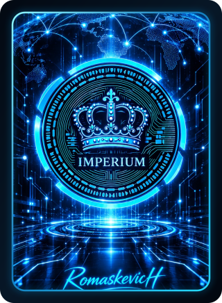
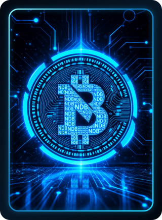
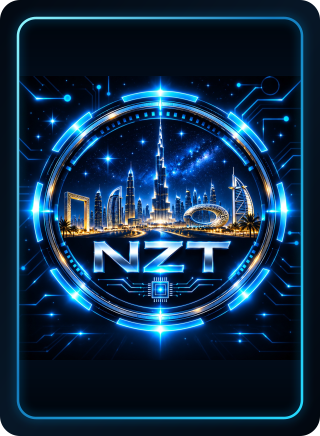

# CRYPTO IMPERIAL Ecosystem — separate digital-asset research boundary

**IMPERIAL Core architectural boundary:** This directory preserves the digital-asset showcase outside the primary engineering, investor, and Dubai championship entry points. Links and the project's historical token names are intentionally preserved; no repository, license, contract, token or on-chain setting has been changed.

**Not part of the operating AI-products evidence.** The **CRYPTO IMPERIAL Ecosystem Boundary** prohibits treating token targets, wallet balances, marketing images, or experimental contracts as proof of working software, company cash, agent payments, real-world adoption or production security. A named smart-contract reference is not an independent contract audit.

**Release and investor separation:** The Dubai 2027 Governed Invoice Exception Agent and the CONSTRUCTOR AI, VELION and CYBER HAK software engineering tracks do not require or execute cryptocurrency/token transfers. Independent on-chain contract checks, liquidity and market valuation remain separate from software demo acceptance.

---

## CRYPTO IMPERIAL Ecosystem

  
  

  

  <a href="https://github.com/oromaskevic23-cmd/IMPERIUM"><strong>IMPERIUM</strong></a> &nbsp;·&nbsp;
  <a href="https://github.com/oromaskevic23-cmd/N.D.B"><strong>NDB</strong></a> &nbsp;·&nbsp;
  <a href="https://github.com/oromaskevic23-cmd/NZT-"><strong>NZT</strong></a>

**IMPERIUM** is a long-term architectural digital currency envisioned for AI agents worldwide.

**NZT** is a separate digital-asset research project with a declared Polygon contract reference. Live on-chain identity, supply and independent security verification remain pending.

**NDB** is a separate token project. This direction is distinct from the software business and explicitly outside the Dubai invoice agent: no token, wallet, blockchain or payment connector is required.

> We make no claim of current global adoption, liquidity, investment returns or an operational agent-payment service.

## Research and disclosure policy

- IMPERIUM remains the **long-term architectural digital currency envisioned for AI agents worldwide**, not a globally adopted currency or a current verified payment rail.
- Cryptographic/token listings are **not** evidence of business revenue, spendable treasury assets, fundraising success, token safety or investor returns.
- Never put real wallet credentials, payment operations or investor claims in the public software demonstration.
- Public presence does not grant a software license; see the corresponding repository's actual licensing notice.
- This separation is **presentation and trust-boundary hygiene only**. No asset has been sold, moved, removed or archived.

**Founder · Owner · CEO:** Alexander Nikolaevich Romaskevich · RomaskevicH.  
[Return to software engineering profile](../README.md).
