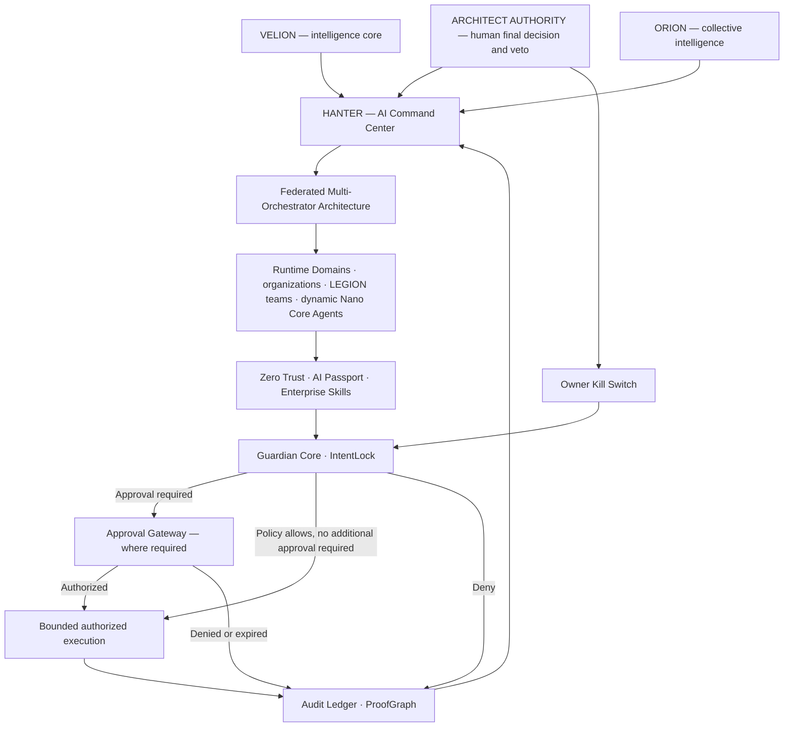

# IMPERIAL Core — One Ecosystem, One Governance Architecture

**Public architecture and evidence map · 19 November 2026**

IMPERIAL Core is a founder-led AI-native ecosystem under development. **Digital State** is its engineering metaphor: a shared constitution of authority, identity, capability, policy, approval and evidence across autonomous organizations. It is not a legal state, government, sovereign jurisdiction, or assertion of a fully deployed network.

## A single mechanism by design

Target architecture only. HANTER coordinates missions; domain orchestrators retain bounded autonomy. Identity is not authority, and a model proposal is not permission. CYBER HAK is the defensive security layer across the execution lifecycle. Public/Private Boundary and CRYPTO IMPERIAL Ecosystem Boundary apply throughout.

## Why multiple repositories?

Repositories are versioned engineering boundaries for specialized components, product surfaces, or experiments. Their count is not a count of independent businesses, deployed services, employees, or active agents. The [dated public registry](FOUNDER_PUBLIC_PROJECT_REGISTRY_20261031.md) classifies them by role. Shared architectural contracts are the intended basis for composition; individual release and integration evidence is still necessary.

## Evidence of composition

| Connection | Public evidence | What is established | Remaining boundary |
| --- | --- | --- | --- |
| VELION → CONSTRUCTOR AI | [Real-model cross-repository CI](https://github.com/oromaskevic23-cmd/VELION-LLM-Public/actions/runs/40683989519) | Actual external NVIDIA Nemotron CPU inference through a signed local API and draft adapter in ephemeral CI; workflow jobs succeeded | No persistent service, proprietary model weights or general autonomous delivery |
| HANTER → federation → NCA | [Executable pilot](https://github.com/oromaskevic23-cmd/HANTER-Public/tree/main/hanter_pilot) · [signed authority reference](https://github.com/oromaskevic23-cmd/HANTER-Public/blob/main/hanter_pilot/ED25519_PASSPORT.md) | Documented local read-only mission and laboratory permit/identity checks | No live fleet, enrolled Owner identity or continuously operating command center |
| HANTER → IMPERIAL-Plugins | [Pinned MCP handoff](https://github.com/oromaskevic23-cmd/HANTER-Public/blob/main/docs/SEARCH_INDEXING_MCP_HANDOFF.md) | Public documentation records an executed cross-repository subprocess contract | Not a live search-indexing operation or production agent |
| Zero Trust → Guardian Core → Approval Gateway → Audit Ledger | [Composition reference](https://github.com/oromaskevic23-cmd/AUDIT-LEDGER#local-persistent-evidence) · [Zero Trust](https://github.com/oromaskevic23-cmd/ZERO-TRUST) · [Guardian Core](https://github.com/oromaskevic23-cmd/GUARDIAN-CORE) · [Approval Gateway](https://github.com/oromaskevic23-cmd/APPROVAL-GATEWAY) | Local component implementations and documented synthetic cross-component check | No production composition, independent QA or external execution claim |
| CONSTRUCTOR AI → exported applications | [Reference CI](https://github.com/oromaskevic23-cmd/CONSTRUCTOR-AI/actions/runs/42001525579) · [Chromium CI](https://github.com/oromaskevic23-cmd/CONSTRUCTOR-AI/actions/runs/42001525556) | Successful workflow jobs for three reviewed templates, exported applications and real browser checks | Arbitrary prompt-to-production acceptance is not established |
| AGY → local mission evidence and stop | [Local protocol CI](https://github.com/oromaskevic23-cmd/AGY/actions/runs/43118953561) | Successful local protocol and offline demo jobs | No live blockchain or external network consensus |

CI jobs listed as successful were checked on 19 November. Project-controlled CI is not independent certification. The local reference and public documentation links are inspectable, not claims of a single production runtime.

## VELION: ownership and provenance

VELION is IMPERIAL Core's intelligence architecture, governed routing and application integration work. The documented inference experiments use third-party model weights (including NVIDIA Nemotron and Qwen); their licenses and attribution remain separate. The ecosystem does not claim proprietary foundation-model training, exclusive ownership of third-party code, or superiority without evaluation. [VELION evidence](https://github.com/oromaskevic23-cmd/VELION-LLM-Public).

## Dubai 2027 — one bounded product

The [Governed Invoice Exception Agent](https://github.com/oromaskevic23-cmd/IMPERIAL-DUBAI-2027-Public) is the public competition-facing product. Its original standalone prototype applies the same architectural principles without claiming deployment of every ecosystem component or importing prior work without eligibility review.

A public synthetic [walkthrough](https://oromaskevic23-cmd.github.io/oromaskevic23-cmd/dubai-2027/) illustrates invoice reconciliation, human review, denied actions and emergency stop. The [signed public checkpoint](https://github.com/oromaskevic23-cmd/IMPERIAL-DUBAI-2027-Public/blob/main/EVIDENCE.md) establishes integrity of a developer-reported summary using a demonstration key, not independent execution or certification. [Model results](https://github.com/oromaskevic23-cmd/IMPERIAL-DUBAI-2027-Public/blob/main/REAL_MODEL_RESULTS.md) record failed quality acceptance; the model is not promoted as accepted. No payment execution, token, wallet or crypto infrastructure is part of this prototype.

## Demonstration and acceptance

- [CONSTRUCTOR AI Template Studio](https://oromaskevic23-cmd.github.io/Capital-Core-Public/reference/constructor-ai/studio/studio.html): public interactive reference; [actual browser-test record](https://github.com/oromaskevic23-cmd/CONSTRUCTOR-AI/actions/runs/42001525556).
- [Dubai walkthrough](https://oromaskevic23-cmd.github.io/oromaskevic23-cmd/dubai-2027/): fixed synthetic examples, not a live AI runtime. Public evidence is dated and scoped.
- Concept artwork is labeled as such. It is not a screenshot, verified credential or proof of deployment. Actual competition browser acceptance and a privacy-safe recording of real execution remain release gates; no such recording is claimed here.
- Independent review should rerun the exact revision, verify negative paths and test evidence provenance. A controlled pilot should compare human baseline time, error rate, human intervention and all costs with agent-assisted work. No savings or customer revenue are claimed before measurement.

## Economic and disclosure boundaries

The CRYPTO IMPERIAL Ecosystem is a separate research boundary. IMPERIUM is a long-term architectural digital currency envisioned for AI agents worldwide, not a claim of current global adoption, liquidity or operational agent payments. Neither tokens nor blockchain are prerequisites for the Dubai invoice prototype.

No private implementation, customer data, credentials, internal infrastructure addresses or confidential architecture are disclosed here. SHPAIZMAN is outside the IMPERIAL Core ecosystem. The public profile is not a representation of government or legal incorporation.

**Alexander Nikolaevich Romaskevich · RomaskevicH** — Founder · Owner · CEO; Architect / Final Architectural Decision Authority.

Architecture → Implementation → Integration → Verification → Evidence.
